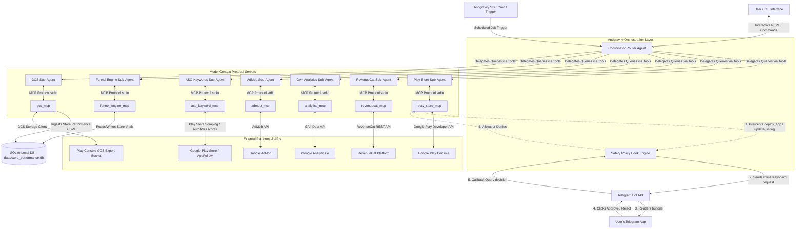

# Data Flow Diagram (DFD) & System Architecture

This document describes the high-level architecture and data flows of the **Kalagato App Management & Growth Agent** built using the Google Antigravity SDK.

---

## 1. Complete System Architecture

The following diagram illustrates how the Coordinator Agent, Specialist Sub-Agents, MCP Servers, and the Human-in-the-Loop (HITL) Telegram Approval policy interact.

---

## 2. Detailed Data Flow Description

### A. Ingestion Loop (Storefront Analyst)
1. **CSV Downloads:** `gcs_mcp` connects to the GCS play console bucket to download raw storefront performance report CSVs.
2. **Database Write:** The Storefront Analyst parses the CSVs and maps metrics (visitors, installs, conversion rates) by country, traffic source, and keyword into the local SQLite database (`data/store_performance.db`).
3. **Synthesis:** `funnel_engine_mcp` reads this SQLite data alongside GA4 and RevenueCat metrics to compute full-funnel activation, retention, and pricing benchmarks.

### B. Execution Loop & Safety Interception (ASO / Deployments)
1. **Action Generation:** The ASO Keyword specialist identifies keyword stuffing or ranking decay and drafts updated storefront listing description metadata (as verified in [update_emi_listing.py](file:///Users/abhishekdhobe/.gemini/antigravity-ide/brain/753ab145-7c3a-463c-b171-aae957d7282c/scratch/update_emi_listing.py)).
2. **Pre-Call Interception:** The agent calls `update_listing` or `deploy_app` on `play_store_mcp`. 
3. **Safety Evaluation:** The Antigravity hook `_PolicyDecideHook` intercepts the call, looking up policies mapped to `play_store/*` tools.
4. **Interactive Approval:** 
   * The policy engine halts execution and dispatches a JSON payload to `https://api.telegram.org/bot{token}/sendMessage` containing inline buttons (`Approve` and `Reject`).
   * The policy engine polls `getUpdates` for 5 minutes.
   * If a callback query is returned with `Approve`, the hook returns `allow=True` and the Play Store API call executes. If the user clicks `Reject` or the request times out, it fails closed, raising an exception to deny execution.
