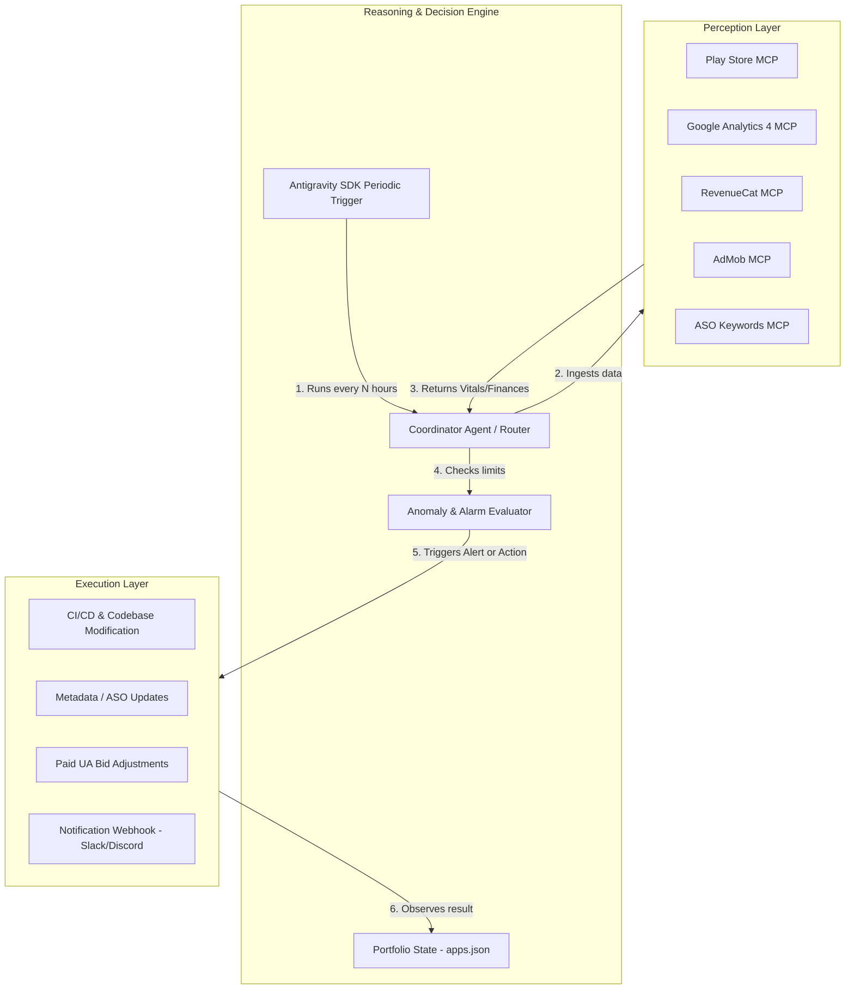

# Autonomous App Management & Growth Agent Plan (agent_plan.md)

This document outlines the research on existing autonomous agents for mobile apps, and defines the architecture, design, and roadmap to evolve the **MCP-GC** system from a reactive, human-triggered REPL into a fully autonomous, closed-loop app management and growth agent.

---

## 1. Industry Research & Similar Agents

Online research of similar autonomous growth and operations agents reveals that the industry is transitioning from passive "copilots" (which only suggest actions) to goal-driven autonomous systems with the following paradigms:

### A. Core Systems & Tools in the Market
* **AppTweak AI Agents:** AppTweak uses autonomous agents to handle keyword analysis, identify search trends, suggest/execute metadata updates, and optimize bid management for Apple Search Ads (ASA).
* **SplitMetrics Iris:** Offers AI agents that automate campaign optimization, budget allocation, and bid adjustments in paid user acquisition channels to maximize ROAS (Return on Ad Spend).
* **IconikAI:** Automates ASO visual assets and description generations, running continuous testing loops to optimize the conversion funnel on store listings.
* **Agentic DevOps & Self-Healing Loops:** Modern DevOps platforms deploy autonomous agents to continuously monitor telemetry (e.g., crash rates, response latency), trigger rollbacks, adjust configurations, and write and run unit tests.

### B. The Closed-Loop Architecture
Industry-standard autonomous agents utilize a **Perception-Reasoning-Action-Observation (PRAO)** loop:
1. **Perception:** Continuous ingestion of structured stream metrics (e.g., Play Console ANR/crash telemetry, GA4 retention, AdMob eCPM, RevenueCat MRR).
2. **Reasoning:** Evaluate context, diagnose root causes, and run predictions against target goals (e.g., "Retention dropped by 10% after Release v1.4; check console crashes").
3. **Action:** Deploy changes (e.g., update store metadata, adjust bids, rollback deployment, or submit a bug patch).
4. **Observation:** Measure the delta in performance metrics over a test window (e.g., 7d) to confirm if the action successfully resolved the issue.

### C. Existing GitHub Repositories & Agent Skills Reference
Rather than building all integration scripts from scratch, we can integrate or reference these active open-source playbooks, skills, and MCP implementations:

* **Google Play / App Store MCP Servers:**
  * **[lusky3/play-store-mcp](https://github.com/lusky3/play-store-mcp):** Connects to the Google Play Developer API to automate releases, APK/AAB uploads, and review responses (currently used).
  * **[BlocktopusLtd/mcp-google-play](https://github.com/BlocktopusLtd/mcp-google-play):** Provides tools for managing store listings, releases, and reviews.
  * **[LobeHub/google-play-mcp](https://github.com/lobehub/google-play-mcp):** Handles subscriptions and review monitoring.
* **Agent Skills & Automated Playbooks:**
  * **[anthropics/skills](https://github.com/anthropics/skills):** Showcase of Anthropic's Agent Skills specification and instruction playbooks.
  * **[google/skills](https://github.com/google/skills):** Official Google repository detailing agent skill files and patterns for cloud and API integrations.
  * **[addyosmani/agent-skills](https://github.com/addyosmani/agent-skills):** Repository featuring software engineering best practices, CI/CD quality gates, and playbooks for coding agents.
  * **[tamtom/gplay-cli-skills](https://github.com/tamtom/gplay-cli-skills):** Pre-built agent skills/playbooks for automated Android build signing, metadata syncing, and release triggers.
  * **[RevenueCat/ai-toolkit](https://github.com/RevenueCat/ai-toolkit):** Codebase plugins and prompts to help coding agents manage billing behavior and subscription updates.
  * **[prash5t/claude-code-mobile-kit](https://github.com/prash5t/claude-code-mobile-kit):** "Idea-to-ship" mobile playbook for Flutter apps on Google Play using automated multi-agent workflows.

---

## 2. Proposed System Architecture

To make MCP-GC autonomous, we will build a continuous execution loop using the **Google Antigravity SDK**, integrating periodic triggers, telemetry-based alarm rules, Slack/Discord notification pipelines, and safety guardrails.



---

## 3. Core Modules & Key Features

### A. Continuous Orchestrator Loop (`Trigger-Action`)
The agent will run in the background using the Google Antigravity SDK's async triggers (`google.antigravity.triggers.every`). 
* **Interval:** The core loop will run every 6 hours (configurable) to ingest daily updates, and every 1 hour for critical vitals (crashes and ANRs).
* **Multi-App Context:** The agent will read a centralized configuration (`apps.json`) to iterate through the entire app portfolio, configuring the subagents with specific credentials dynamically.

```python
# Conceptual execution script: run_autonomous_loop.py
import asyncio
from google.antigravity import Agent, LocalAgentConfig
from google.antigravity.triggers import every, TriggerContext
from app_manager.loop_handler import execute_health_check_turn

async def portfolio_cron_handler(ctx: TriggerContext):
    # Retrieve all apps from portfolio configuration
    apps = load_portfolio_config()
    for app in apps:
        # Pushes context to the agent to inspect the current app
        await ctx.send(f"Inspect status, check vitals, and evaluate growth opportunities for app: {app['name']}")

# Setup trigger to run every 6 hours
health_trigger = every(21600, portfolio_cron_handler)

config = LocalAgentConfig(
    system_instructions="You are the Autonomous Portfolio Manager...",
    triggers=[health_trigger],
    policies=[...], # Safety policies
)

async def main():
    async with Agent(config) as agent:
        # Agent starts and runs triggers in background loop
        while True:
            await asyncio.sleep(3600)
```

### B. Anomaly & Alarm Engine
An evaluation rules engine checks key metrics against historical benchmarks. If a threshold is violated, the agent raises an alarm:
* **Crash/ANR Spike Alarm:** Triggered if Play Console crash or ANR rates exceed `1.0%` within a 24-hour window. Action: Alert team, suggest rollout halt.
* **Revenue / MRR Drop Alarm:** Triggered if daily MRR drops by `> 15%` compared to the 7-day trailing average. Action: Run diagnostic on paywall conversions, check RevenueCat subscription logs.
* **AdMob Mediation eCPM Drop:** Triggered if CPM drops by `> 25%` on key ad placements. Action: Audit mediation groups and waterfall configurations.
* **ASO Keywords Decay:** Triggered if core high-volume keywords drop in organic ranking by `> 5` positions. Action: Generate updated store metadata candidates.

### C. Communication & Command Pipeline (Notification Layer)
Rather than waiting for a terminal prompt, the agent sends structured updates to communication channels (e.g., Slack, Discord, Telegram):
* **Format:** Custom Slack block kit notifications summarizing daily metrics, alarm alerts, and recommended code-fixes.
* **Interactive Approvals:** Integrating Slack Interactive Buttons so developers/PMs can click `[Approve Update]` or `[Deploy Fix]` directly from the chat channel.

### D. Safety Guardrails & Access Policies
Because the agent can perform destructive actions (e.g., modifying live code or altering paid ad campaigns), we leverage the Antigravity SDK’s declarative policy system:
* **Production Deployment Policies:** Shell commands like `git push` or CI/CD deployments are blocked by default and require explicit human-in-the-loop validation:
  ```python
  from google.antigravity.hooks import policy
  
  # Ask for user confirmation on any deployment-related run_command
  policy.ask_user(
      "run_command",
      when=lambda args: "deploy" in args.get("CommandLine", "").lower() or "push" in args.get("CommandLine", "").lower(),
      handler=slack_interactive_approval_handler
  )
  ```
* **Budget Caps for Google Ads:** Implement strict predicates denying bid modifications that increase daily budgets by more than 20% or exceed a hard cap of $100/day.

### E. Subscription Value Loop Diagnostic Engine
To operationalize Phil Carter's **Subscription Value Loop** (as outlined in [Subscription-Value-Loop-Complete-Guide.md](file:///Users/abhishekdhobe/Code/MCP-GC/Subscription-Value-Loop-Complete-Guide.md)), the agent will function as a continuous diagnostic and benchmarking engine:

1. **Metrics Harvesting (Perception):**
   The agent queries GA4, RevenueCat, and Google Play Console via MCP servers to collect the standard inputs for the Value Loop:
   * **Value Creation:** Signup Rate, monthly/annual subscriber retention cohorts, average subscriber lifetime, and onboarding activation rate.
   * **Value Delivery:** Organic vs. paid acquisition ratios, Word of Mouth Coefficient (WoMCo), ASO keyword rankings, and blended CAC/CPI.
   * **Value Capture:** Trial Start Rate, Trial-to-Paid Conversion Rate, plan mix (annual vs. monthly), prices, and dunning success rates.

2. **Automated Benchmarking (Reasoning):**
   * The agent reads the app's category and revenue tier from `apps.json`.
   * It maps harvested metrics against industry-standard benchmarks (e.g. top-quartile 6% install-to-paid conversion, 40% retention) stored in reference tables.
   * The reasoning engine groups underperforming metrics to calculate the single most restrictive bottleneck stage (Creation, Delivery, or Capture).

3. **Bottleneck-Directed Actions (Execution):**
   * **If Value Creation is the Bottleneck:** The agent initiates code audits on the onboarding flow, checking why users fail to trigger activation events (e.g. `onboarding_completed`), audits crash/ANR traces, and reviews qualitative reviews mentioning bugs.
   * **If Value Delivery is the Bottleneck:** The agent triggers ASO keyword keyword scraping, analyzes competitor metadata gaps, and suggests localized store descriptions or adjusts search campaign bids.
   * **If Value Capture is the Bottleneck:** The agent audits paywall display triggers in the code, evaluates payment methods (APMs) availability, and structures pricing promotions or Gabor-Granger price sensitivity studies.

---

## 4. Implementation Roadmap

### **Phase 1: Observation, Ingestion & Alerts (Timeline: Weeks 1-2)**
* **Objective:** Establish the passive monitor loop, cloud performance report ingestion, and local SQLite metrics storage.
* **Deliverables:**
  * Build the background loop script (`run_autonomous_loop.py`) using Antigravity triggers.
  * Define `apps.json` for portfolio management.
  * Integrate a Slack Notification Webhook.
  * Implement the basic alarm engine (ANR/Crash tracking and daily MRR digests).
  * **[NEW] GCS Storefront Analyst Ingest Subagent & Database Layer:** Build the `storefront_analyst` subagent to parse monthly and daily store performance report CSVs from GCS, saving derived conversion metrics to a local SQLite database (`data/store_performance.db`) via `SQLModel` ORM mapping. Expose these database tables via new query tools in `funnel_engine_mcp`.

### **Phase 2: Human-in-the-Loop Operations (Timeline: Weeks 3-4)**
* **Objective:** Enable the agent to suggest and execute non-destructive metadata and ASO updates.
* **Deliverables:**
  * Integrate ASO keywords optimization loops (scraped keyword analysis + Google Play Store updates).
  * Build the Slack approval handler to capture interactive approvals.
  * Implement the safety policy manager.

### **Phase 3: Autonomous UA & Ads Bidding (Timeline: Weeks 5-6)**
* **Objective:** Optimize ad network conversions.
* **Deliverables:**
  * Integrate the official `google-ads-mcp` to adjust bids on active search campaigns.
  * Implement bid adjustment rules based on ROAS targets pulled from Funnel Engine.

### **Phase 4: Self-Healing Codebase Modifications (Timeline: Weeks 7-8)**
* **Objective:** Allow the agent to patch codebase crashes or instrument analytics.
* **Deliverables:**
  * Setup GitHub Action pipelines for agent pull requests.
  * Implement the auto-patching loop: Agent reads stack trace from GCS/Play Store console -> Locates file -> Runs test -> Fixes codebase -> Creates Pull Request.
  * Auto-instrumentation of missing GA4 events via `EVENTS.md` analysis.

---

## 5. Missing Capabilities & Ecosystem Expansion

To build a comprehensive, cross-platform app management system, the current architecture needs to expand beyond Google Play Store and basic analytics. The following additions will round out the ecosystem:

### A. iOS Platform Visibility (App Store Connect MCP)
* **Why it's missing:** Currently, we only support Android (`play_store_mcp`). Since Kalagato operates iOS apps, the agent is blind to half of the portfolio's vitals, reviews, and releases.
* **Capabilities:** Connect to the App Store Connect API to ingest iOS crash logs, sales/trends reports, subscription events, and push test flights or production builds.

### B. UI/UX & Creative Assets (Mobbin MCP / Store Visuals Scraping)
* **Why it's missing:** Optimizing onboarding conversion rates and paywalls requires visual reference and layout inspiration from top-quartile apps in the same category.
* **Capabilities:** Fetch screenshots, onboarding sequences, design patterns, and paywall layouts from UI reference databases like Mobbin, allowing the agent to suggest design revisions grounded in real competitor visuals.

### C. A/B Testing & Dynamic Logic (Firebase Remote Config / GrowthBook MCP)
* **Why it's missing:** To execute growth tests autonomously (e.g. testing pricing models or paywall layouts), the agent must be able to modify app behavior dynamically without pushing a new build every time.
* **Capabilities:** Read and update feature flags, target variables, and user segmentation rules directly via Firebase Remote Config or GrowthBook.

### D. Multi-Channel Paid User Acquisition (Meta Ads / Apple Search Ads MCP)
* **Why it's missing:** We support Google Ads, but mobile user acquisition is highly multi-channel. To optimize blended CAC, the agent needs visibility into all ad networks.
* **Capabilities:** Connect to the Meta Ads API and Apple Search Ads API to dynamically allocate budgets across channels, adjust bids, and audit active creatives.

### E. Lifecycle Marketing & Push Reminders (OneSignal / Braze MCP)
* **Why it's missing:** In the Subscription Value Loop, driving *repeatable* engagement requires bringing users back to the app via push notifications, email campaigns, or in-app alerts.
* **Capabilities:** Trigger promotional code campaigns, win-back pushes for trial churners, and streak/habit reminders using OneSignal, Braze, or Firebase Cloud Messaging.

### F. Professional ASO Intelligence (AppTweak / Sensor Tower API)
* **Why it's missing:** Our current ASO tool scrapes basic keyword suggestions. A professional ASO loop requires competitive share of voice, historical rank tracking, and download estimates.
* **Capabilities:** Query AppTweak or Sensor Tower APIs to pull robust competitive benchmarks and keyword volumes.
